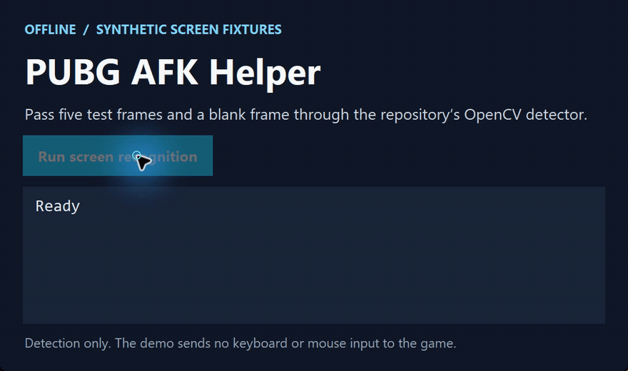

# PUBG AFK Helper

[简体中文](https://github.com/chenbinghan666/pubg-afk-helper/blob/main/README.md) · [English](https://github.com/chenbinghan666/pubg-afk-helper/blob/main/docs/locales/README.en.md) · [日本語](https://github.com/chenbinghan666/pubg-afk-helper/blob/main/docs/locales/README.ja.md) · [Deutsch](https://github.com/chenbinghan666/pubg-afk-helper/blob/main/docs/locales/README.de.md) · **Français** · [Español](https://github.com/chenbinghan666/pubg-afk-helper/blob/main/docs/locales/README.es.md) · [Português](https://github.com/chenbinghan666/pubg-afk-helper/blob/main/docs/locales/README.pt.md)

Utilise OpenCV pour reconnaître les écrans de PUBG, afficher l’état de la détection et exécuter des séquences configurables sous Windows. Comprend un aperçu limité à la détection et des tests de régression hors ligne.

Python · OpenCV · Windows

[](https://github.com/chenbinghan666/pubg-afk-helper/actions/workflows/tests.yml)
[](../../LICENSE)


Outil de processus automatique PUBG basé sur la reconnaissance d'écran **OpenCV, la saisie de simulation Windows et la détection de changement de mini-carte**.
Identifiez l'interface du lobby et de la caisse, effectuez des processus de correspondance, de saut, de déplacement, de récupération et d'échappement configurables, et affichez l'étape en cours dans la fenêtre d'état des frais généraux.

## Démonstration

Teste le détecteur OpenCV sur cinq images synthétiques et vérifie qu’une image vide ne produit aucun résultat.

[](../../docs/images/project-demo.mp4)

[Télécharger le MP4](../../docs/images/project-demo.mp4?raw=true)

## Fonction

- L'interface **reconnaît** : lobby, retour au lobby, confirmation de sortie, règlement du personnage et page de récompense ; confirmation de reconnaissance continue et limitation des opérations répétées.
- Positionnement relatif **** : redimensionnez le modèle et les coordonnées en fonction de la taille de l'écran et prenez en charge la recherche alignée sur les bords pour certaines mises en page grand écran.
- Processus de jeu **** : saut dans le temps après la disparition de la salle, tournez une fois à droite, W + Maj gauche pour continuer à avancer, cliquez sur F pour reprendre après avoir regardé en bas.
- **Mini carte anti-coincement mural** : comparez uniquement le terrain de la carte dans le coin inférieur droit et bloquez la marque de caractère centrale ; essayez d'abord Shift+C, puis reculez et déplacez-vous à gauche et à droite en fonction des résultats de détection.
- **Fenêtre d'état supérieure** : affiche le compte à rebours, les actions, les raisons de pause et les indicateurs de détection de mini-carte ; la pénétration de la souris ne vole pas le focus du jeu.
- **configurable et testable** : configuration JSON, outil d'enregistrement de modèles, tests de régression hors ligne, Windows CI.

Le programme fonctionne via des captures d'écran et des entrées normales du système d'exploitation, ne lit pas la mémoire du jeu et n'injecte pas de processus de jeu.
Le projet en est encore à ses débuts ; Les horaires fixes et les modifications de la mini-carte sont approximatifs et ne peuvent pas confirmer l'avion, l'atterrissage réel, le succès de la prise en charge ou la réception de la récompense.
Veuillez confirmer vous-même les règles du jeu et les risques du compte avant utilisation ; ce projet ne fournit pas de fonctions de contournement anti-triche.

## démarrage rapide

Nécessite **Windows 10/11, Python 3.11+**, le jeu utilise le mode fenêtre sans bordure du moniteur principal.

1. Téléchargez `PUBG-helper.zip` dans la dernière version ](https://github.com/chenbinghan666/pubg-afk-helper/releases/latest) de [ ou clonez ce référentiel.
2. Installez Python et cochez **Ajoutez Python à PATH**.
3. Double-cliquez sur `install.cmd` et attendez la fin de l'installation des dépendances.
4. Lorsque vous l'utilisez pour la première fois, double-cliquez sur **`preview.cmd`**, revenez au jeu et vérifiez le journal de reconnaissance ; ce mode n’envoie pas d’entrée.
5. Après avoir confirmé que la reconnaissance est correcte, fermez l'aperçu et double-cliquez sur **`launch.cmd`** pour activer le fonctionnement automatique.

```powershell
git clone https://github.com/chenbinghan666/pubg-afk-helper.git
cd pubg-afk-helper
python -m venv .venv
.\.venv\Scripts\python.exe -m pip install -r requirements.txt
.\.venv\Scripts\python.exe bot.py             # Reconnaître seulement
.\.venv\Scripts\python.exe bot.py --live      # Activer la saisie
```

Les clones Git lisent `config.example.json` par défaut. Copiez-le dans `config.json` avant la personnalisation, et la configuration locale ne sera pas soumise à Git :

```powershell
Copy-Item config.example.json config.json
```

L'entrepôt est livré avec un ensemble de modèles de recadrage de boutons pour l'interface chinoise traditionnelle. Si la langue, la version du jeu, l'échelle ou la disposition du HUD sont différentes, le modèle doit être réenregistré et il ne peut pas être garanti qu'il soit directement applicable à tous les ordinateurs.

## Processus par défaut

```text
Identifier la salle → F commence à correspondre
  → Disparition de lobby détectée 3 fois de suite → attends 120 secondes
  → F Essayez le parachutisme → tourner à droite une fois → W + Maj gauche
  → 30 secondes après le saut en parachute : regarder le sol → Appuyez sur F toutes les 0,5 secondes
  → La mini-carte est stable pendant environ 1 seconde : essayez de traverser, de revenir en arrière si nécessaire
  → Décès/Règlement : Relâcher le bouton → Retour au lobby → prochain tour
```

La disparition du lobby peut aussi être un écran de chargement, qui ne prouve pas que vous êtes entré dans la salle. Tous les horaires sont réglables.
Le déplacement par défaut pour le virage à droite **4050** et le déplacement vers le haut **5000** ne sont que des paramètres de référence ; l'angle réel dépend de la sensibilité du jeu et des paramètres de la souris.
Le sprint et les sauts Shift+C doivent être cohérents avec la touche de jeu et les paramètres de maintien/basculement.

## Touches de fonctionnement

| Bouton | fonction |
| --- | --- |
| **F8** | Pause uniquement, libérant les clés détenues par le script |
| **F7** | Continuez simplement |
| **F9** | Sortez et relâchez la clé |
| **Ctrl+C** | Arrêter le programme dans le terminal |

La saisie est interrompue lors de la sortie du jeu et reprendra automatiquement après le retour ; le compte à rebours qui a commencé est toujours calculé sur la base du temps réellement écoulé.
La pause dans le coin de la souris est désactivée par défaut pour éviter l'oubli automatique de la protection contre les déclencheurs et peut être activée individuellement avec `mouse_corner_pause`.
Le nettoyage des frappes au clavier ne peut pas être effectué lorsque le processus est interrompu de force ou que l'ordinateur est éteint.

## Configuration et dépannage

Pour connaître les paramètres complets, les commandes d'enregistrement du modèle, la zone relative de la mini-carte et la méthode d'étalonnage de la sensibilité, veuillez vous référer au manuel de configuration et d'utilisation du [](../../docs/CONFIGURATION.md).

| question | Contrôle prioritaire |
| --- | --- |
| Aucune reconnaissance ni action | Si la fenêtre supérieure affiche une pause, si le jeu est au premier plan et si le titre de la fenêtre contient `PUBG` |
| Échec du démarrage ou de la reconnaissance du règlement | Si la langue de l'interface, la résolution et l'échelle du HUD correspondent au modèle |
| Saut en parachute trop tôt / trop tard | `movement.jump_delay_seconds` |
| Décrocher trop tôt/regarder dans la mauvaise direction | Paramètres d'inversion des axes `pickup_delay_after_jump_seconds`, `look_down_pixels` et Y |
| Mauvais angle de virage à droite | Calibrer en fonction de l'angle de rotation réel `turn_right_pixels` |
| Sprint ou saut n’a aucun effet | Affectation des touches, mode attente, autorisations d'exécution et si le jeu accepte l'entrée analogique |
| Mauvaise évaluation/manquant du mur anti-brouillage | Indicateurs d'échelle stables pour la zone de la mini-carte, le zoom, les paramètres de rotation et les fenêtres aériennes |

Le journal est écrit dans le `bot.log` local. Veuillez supprimer le compte, le chat, le chemin privé et d'autres informations avant de donner votre avis.

## développer

```powershell
.\.venv\Scripts\python.exe -m unittest -v
.\.venv\Scripts\python.exe package.py
```

Le test simule la saisie au clavier et à la souris sans faire fonctionner le jeu. La version publique génère automatiquement des images synthétiques à des fins de test ; s'il existe localement
`reference_screens/`, vous pouvez utiliser les captures d'écran de référence personnelles correspondantes pour une régression supplémentaire. Ce répertoire n'est pas inclus dans le package d'entrepôt ou de distribution.
CI exécute des tests sur Windows en utilisant Python 3.11 et 3.12.
Les tests hors ligne ne peuvent pas remplacer la vérification réelle du jeu sous différents matériels, versions de jeu et sensibilités.

Fichiers principaux : `bot.py` est la machine d'état, la reconnaissance et l'implémentation de la saisie, `status_overlay.py` est la fenêtre d'état,
`prepare_templates.py` est un outil de génération de modèles à cinq interfaces et `package.py` est un script de création de package de distribution.

Bienvenue pour signaler des problèmes reproductibles via [Issues](https://github.com/chenbinghan666/pubg-afk-helper/issues).
Veuillez lire les instructions de contribution [](../../CONTRIBUTING.md) avant de soumettre des modifications. Pour les enregistrements de version, voir [CHANGELOG](../../CHANGELOG.md).

## licence

Le code original et la documentation sont sous licence [MIT License](../../LICENSE). La découpe de l'interface du jeu, le nom et la marque appartiennent toujours à leurs titulaires de droits respectifs, veuillez consulter la déclaration tierce de [](../../NOTICE.md) pour plus de détails. Ce projet n'a aucune affiliation ni partenariat officiel avec KRAFTON / PUBG.
